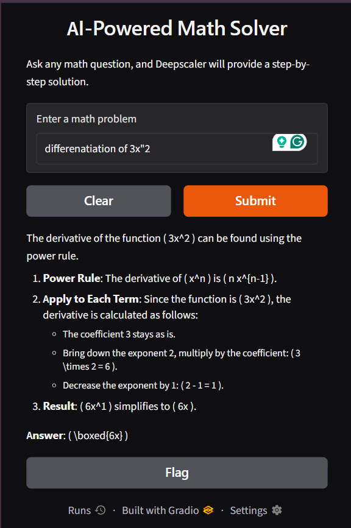

# DeepScaleR AI Projects

This repository contains two local AI interfaces powered by Ollama:

- **Chatbot**: a Gradio chat UI and an optional FastAPI endpoint.
- **Math solver**: a Gradio interface for submitting math problems.

Both applications send prompts to a model running in your local Ollama service. The chatbot uses the model name `deepscaler-chat`; the math solver uses `deepscaler`.

## About DeepScaleR

[DeepScaleR-1.5B-Preview](https://huggingface.co/agentica-org/DeepScaleR-1.5B-Preview) is a reasoning-focused language model fine-tuned from DeepSeek-R1-Distill-Qwen-1.5B using reinforcement learning and longer reasoning contexts. It is intended for tasks that benefit from multi-step reasoning, especially mathematics and competition-style problems.

This repository uses Ollama to run a local model:

- The **math solver** sends math questions to the Ollama model named `deepscaler`.
- The **chatbot** uses `deepscaler-chat`, created from `ChatbotAIApp/Modelfile` with `deepscaler` as its base and a conversational system instruction.

The Ollama name is a local model tag; it does not by itself verify which model weights are installed. The repository does not include model weights, and answers can be incorrect, so verify important results.

## Prerequisites

- Python 3.12 or newer
- [uv](https://docs.astral.sh/uv/getting-started/installation/) for Python environment and dependency management
- [Ollama](https://ollama.com/download) installed and running
- An Ollama model available locally under the name `deepscaler`

The repository does not include model weights. If your compatible model has a different local name, create the `deepscaler` name with `ollama cp <existing-model> deepscaler` (replace `<existing-model>` with its Ollama name).

## Install locally

From the repository root, install the Python dependencies and create the project environment:

```powershell
uv sync
```

Make sure Ollama is running and that the `deepscaler` model is available. Then create the chatbot model variant defined by the repository's Modelfile:

```powershell
ollama create deepscaler-chat -f ChatbotAIApp/Modelfile
```

The Modelfile uses `deepscaler` as its base model, so that model must be available before this command runs.

## Run an application

Run each command from the repository root in its own terminal.

### Chatbot UI

```powershell
uv run python ChatbotAIApp/chatbot_ui.py
```

Open the local URL printed by Gradio in your browser.

### Math solver

```powershell
uv run python MathSolverApp/math_solver.py
```

Open the local URL printed by Gradio in your browser.



### Chatbot API (optional)

```powershell
uv run uvicorn chatbot_api:app --app-dir ChatbotAIApp --host 0.0.0.0 --port 8000 --reload
```

The API is available at `http://127.0.0.1:8000`. Visit `/docs` for interactive API documentation. The `GET /chat` endpoint accepts a `message` query parameter, for example `http://127.0.0.1:8000/chat?message=Hello`.

## Troubleshooting

- **Cannot connect to Ollama**: start the Ollama application/service, then retry.
- **Model not found**: confirm the model is available with `ollama list` and that it is named `deepscaler`; also create `deepscaler-chat` using the command above before running the chatbot.
- **Python dependency issues**: run `uv sync` again from the repository root.
